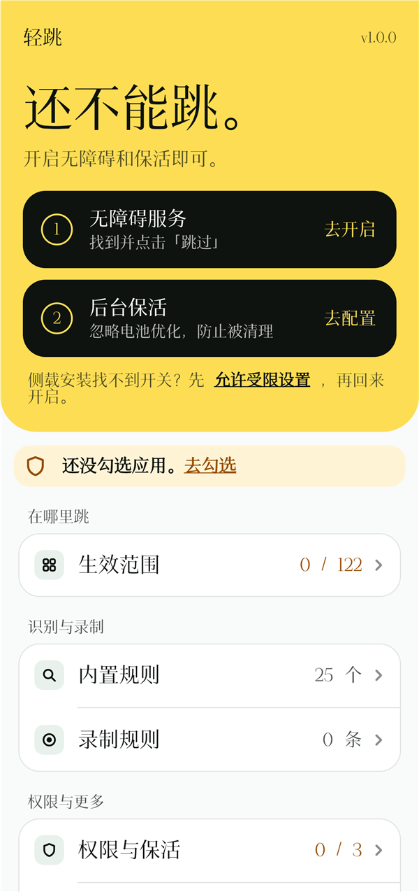
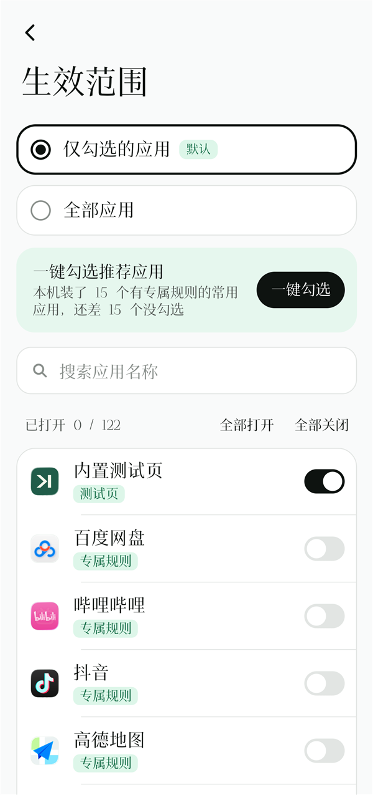
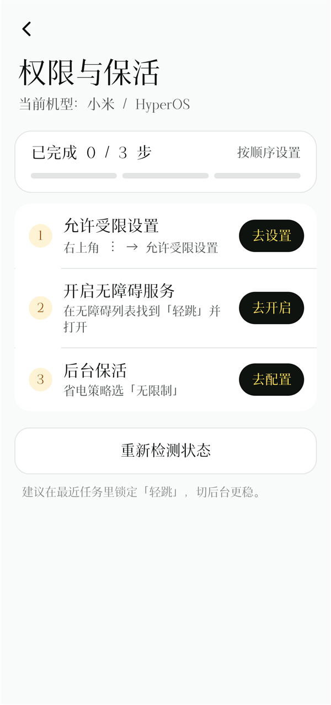

<div align="center">

# 轻跳 · LightSkip

**仅检查更新时联网、零第三方依赖、克制的 Android 开屏跳过工具**


-176238?style=flat-square)


</div>

---

## 真机界面（小米 15 / HyperOS 实拍）

| 首页状态总览 | 生效范围（白名单默认） | 权限与国产 ROM 保活 |
| :---: | :---: | :---: |
|  |  |  |
| 两步直达无障碍与保活，隐私边界一目了然 | 默认仅在勾选应用中生效，支持一键勾选推荐应用 | 自动识别机型与 ROM，三步顺序指引并实时检测 |

---

## 核心特性

- **仅检查更新时联网 · 不上传任何本机数据**：日常跳广告完全离线，无障碍服务绝不发起网络请求；仅在检查更新与下载新版安装包时连接 GitHub Releases，强制 HTTPS 与 SHA-256 校验，且关闭应用备份（`allowBackup="false"`）。
- **克制的生效边界**：默认采用「仅勾选的应用」白名单模式，内置规则自动避开支付与银行类敏感界面。
- **内置规则 + 本地录制**：内置 25 套常见应用专属规则，同时支持本地录制自定义跳过规则与内置测试页验证。
- **国产 ROM 保活指引**：自动识别小米 HyperOS 等国产系统，提供「受限设置 → 无障碍服务 → 后台保活」分步直达入口。
- **纯原生零依赖**：纯 Java + Android SDK 编写（`applicationId: app.qi.qingtiao`），无第三方 UI 或统计库，源码轻量透明。

---

## 权限说明

全应用仅在 `AndroidManifest.xml` 声明以下必要权限与服务：

| 权限 / 服务 | 用途 |
| --- | --- |
| `BIND_ACCESSIBILITY_SERVICE` | 监听勾选应用的开屏界面并执行「跳过」点击（无障碍服务绝不联网） |
| `QUERY_ALL_PACKAGES` | 在「生效范围」页面列出本机已安装应用供勾选 |
| `REQUEST_IGNORE_BATTERY_OPTIMIZATIONS` | 引导开启「无限制」省电策略，减少后台被杀 |
| `INTERNET` | 仅在检查更新与下载新版 APK 时访问更新源，不上传任何本机数据 |
| `REQUEST_INSTALL_PACKAGES` | 新版 APK 通过 SHA-256 校验后，拉起系统安装器完成应用内升级 |

> **不包含** 定位、通讯录、外部存储读写等任何无关权限；不收集、不上传任何本机数据。

---

## 首次使用（3 步配置）

1. **允许受限设置**（Android 13+ 侧载安装需要）：在「权限与保活」点击第 1 步进入应用信息 → 右上角 `⋮` → `允许受限设置`。
2. **开启无障碍服务**：在系统无障碍列表中找到「轻跳」并开启。
3. **后台保活**：将省电策略设为「无限制」，并建议在最近任务中锁定「轻跳」。

---

## 本地构建与测试

环境要求：**JDK 17**、**Android SDK 35**。

```bash
# 运行全部本地单元测试
./gradlew testDebugUnitTest

# 构建 Debug APK
./gradlew assembleDebug

# 安装到已连接的真机
adb install -r app/build/outputs/apk/debug/app-debug.apk
```

静态官网落地页源码位于 `docs/index.html`（零外部 CDN，可直接本地预览或开启 GitHub Pages `/docs` 托管）。

---

## 使用声明

本项目仅用于 **个人技术学习与亲友小范围自用**，不上架任何应用商店，不提供商业化分发或服务。